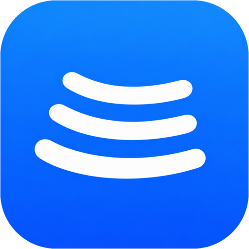

<div align="center">



# Tunes

### A YouTube Music player for Android and Chrome

[](https://github.com/Hem456anth/Tunes/releases/latest)
[](LICENSE)

</div>

Tunes is free software under the GNU General Public License v3.0; see `LICENSE`.
The Android app covers playback, downloads, Automix, lyrics, Replay, widgets, Android Auto,
scrobbling, Discord, local files, Spotify, Chromecast and sign-in. The repository also holds **Tunes for Chrome**, a side-panel
player extension (see [`extension/`](extension/README.md)).

## Download

- **Android:** get `Tunes-<version>-arm64.apk` from the
  [latest release](https://github.com/Hem456anth/Tunes/releases/latest) (Android 8.0 or newer,
  64-bit phones). Allow "Install unknown apps" for the app you open it with. Tunes checks for
  updates itself and offers new versions in the app.
- **Chrome:** see [`extension/README.md`](extension/README.md) to load it unpacked.
- Every Tunes APK is signed with the same key, so updates install over older versions.
  Certificate SHA-256: `963fa6cdbcedd9d6970b37acb42c28674b45b6215fa62bde799b2ac6eeb1f067`

## What's new

### 3.1.2 (19 Oct 2026)
- Swiping Tunes away from Recent Apps now stops the music, clears the notification and releases
  audio focus, like other players. Your queue and position are saved.
- Want music to keep going after closing the app? Turn off Settings → "Stop music on close from
  recents". Playback also keeps going when Android Auto is connected.

### 3.1.1 (18 Oct 2026)
- The 3.0 **Explore** is back: grouped sections of colorful two-column mood and genre cards.
- The 3.0 **Search** is back: text suggestions with a "Search 'term'" row first, no media cards
  while typing, plain song rows, and recent searches shown as the words you typed.
- Everything else from 3.1.0 is unchanged.

### 3.1.0 (18 Oct 2026)
- Spotify playlists and Liked Songs, Chromecast, built-in equalizer, lyric translation and
  romanization, Listen Together, SMB/WebDAV libraries, playlist reorder, and redesigned queue and
  artist pages.
- Continue from Tunes for Chrome: a YouTube Music link with `t=` (the extension's Continue on
  Phone QR code) opens the song at that second. Sharing from the player adds the position, so the
  extension can continue it too.
- The desktop app isn't part of Tunes (it bundled Apple's SF Pro fonts, which can't be
  redistributed).

### 3.0.0 (17 Oct 2026)
- First Tunes release.

## Highlights

- **Identity:** package `app.tunes.music` (dev flavor `app.tunes.music.dev`),
  name "Tunes", version 3.1.2 (versionCode 6), blue logomark and launcher icon. Installs
  over every earlier Tunes release (same signing key). Internal Kotlin package names are
  unchanged.
- **Blue instead of red:** every red button and accent (delete, sign out, remove
  source, download retry, Replay badges and poster, launcher gradient, logo SVG)
  is now blue: `ActionBlue` (#4A94FF on dark, #005BD3 on light, both ≥4.5:1)
  and `AccentBlue` (#0A60FF, white text 5.1:1). Error *status text* stays red so
  failures still read as failures.
- **Fonts:** Apple's SF Pro Display is not licensed for redistribution, so it is
  replaced with Inter (SIL OFL 1.1, `Inter-OFL.txt`), static instances per weight.
- **Security:** Android auto-backup and device-transfer are off
  (`allowBackup=false`, all domains excluded), so sign-in cookies and account
  tokens can't be restored onto another device. The Spotify token WebView, which
  carries a JavaScript bridge, can no longer navigate off `*.spotify.com`.
- **Updates and links:** the in-app update checker reads
  `github.com/Hem456anth/tunes` releases. Folders (`Music/Tunes`, `Pictures/Tunes`),
  file names and notifications say Tunes. Older backups still import.
- **Explore and Search:** kept as in Tunes 3.0: the sectioned mood grid, text-only
  suggestions and typed recent searches, instead of the v1.8 redesign.
- **Build:** `TUNES_PREBUILT_NATIVE_DIR` lets hosts without an NDK package
  prebuilt native libraries (built from `native/` and `app/src/main/cpp/` in this repo)
  instead of compiling them.

## Build

```
# keystore.properties (gitignored) points at your release key
./gradlew :app:assembleProdRelease     # app/build/outputs/apk/prod/release/
./gradlew :app:testProdReleaseUnitTest
```

Optional `local.properties` keys: `LASTFM_API_KEY`, `LASTFM_SECRET`,
`MODULE_INDEX_URL` (unset: Last.fm sign-in and HQ modules stay off, as upstream).

## Features

#### Playback
- **Search, browse and play** anything on YouTube Music, with the Explore mood grid and text search suggestions.
- **Hi-Res lossless audio** (FLAC/ALAC) from a configured module source, with YouTube Music as the fallback.
- **Gapless playback with crossfade** (0–12 s) and **Automix [Beta]**: DJ-style transitions with beat-matching.
- **Offline downloads** with embedded metadata, plus your **local music**, SMB and WebDAV libraries.
- **Background playback**, lock-screen and Bluetooth controls, Android Auto, widgets and Chromecast.
- **Continue from Chrome**: open a link from Tunes for Chrome and pick up at the same second.

#### Lyrics and look
- **Word-synced lyrics** from many providers, with translation and romanization.
- **Animated album canvas** and artwork-driven colors, with a blue Tunes accent.
- **Frosted-glass bars** and Material 3 design.

#### Accounts and controls
- **Google sign-in** for your YouTube Music library, **Spotify** playlists and Liked Songs.
- **Scrobbling** to Last.fm and ListenBrainz, **Discord** Rich Presence and **Listen Together**.
- **Per-network audio quality**, playback speed (0.5×–2×), skip silence, sleep timer, a built-in equalizer and Stats for nerds.

## Tunes for Chrome

A side-panel music player for Chrome lives in [`extension/`](extension/README.md): Listen Now,
Explore, Library and Search, synced lyrics, podcasts, playlists, and Continue on Phone to hand a
song to the Android app.

## Contributing

Issues and pull requests are welcome. Please read the [Contributing Guide](CONTRIBUTING.md) and
[Code of Conduct](CODE_OF_CONDUCT.md) first. See also [Maintainers](MAINTAINERS.md) and
[Additional Docs](ADDITIONAL.md).

## Credits

- Lyrics animation inspired by [binimum/am-lyrics](https://github.com/binimum/am-lyrics). Lyrics
  providers: [lrc.red](https://lrc.red), [BiniLyrics](https://github.com/binimum),
  [BetterLyrics](https://github.com/better-lyrics/better-lyrics), [PaxSenix](https://lyrics.paxsenix.org),
  [LyricsPlus](https://github.com/ibratabian17/YouLyPlus), [SimpMusic](https://github.com/maxrave-dev/SimpMusic),
  [Unison](https://unison.boidu.dev), [Megalobiz](https://www.megalobiz.com), [KuGou](https://www.kugou.com),
  [LRCLIB](https://lrclib.net), [Musixmatch](https://www.musixmatch.com) and [Genius](https://genius.com).
- Inter font by Rasmus Andersson (SIL OFL 1.1, `Inter-OFL.txt`).

## Disclaimer

> [!IMPORTANT]
> Tunes is not affiliated with, endorsed by, or connected to YouTube, Google, Spotify or Apple.

- **No media hosting:** Tunes doesn't host, upload or store copyrighted music. It plays files on
  your device or streams from public or signed-in services.
- **Your responsibility:** Tunes is made for personal and educational use. You're responsible for
  following your local copyright laws and the terms of the services you use.
- **Ads:** Tunes never blocks, skips or mutes YouTube's ads.
- **Copyleft:** Tunes is free software under GPL-3.0. Anyone may redistribute it, but every
  distribution must include the source under the same license.

## License

GNU General Public License v3.0. See [LICENSE](LICENSE). The copyright notices of the original
authors are kept in the source files, as the license requires.
