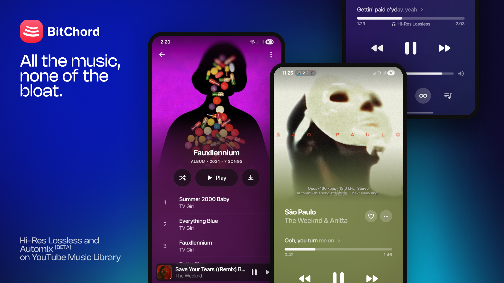

<div align="center">


# Tunes

### A YouTube Music client for Android, built from BitChord

</div>

Tunes is a fork of [BitChord](https://github.com/kushagrasinghx/BitChord) v1.5.1
(commit `05f4be9`, tag `v1.5.1`) by Kushagra Singh, released under the
GNU General Public License v3.0. Tunes stays under GPL-3.0; see `LICENSE`.
Every feature of BitChord 1.5.1 is kept: playback, downloads, Automix, lyrics,
Replay, widgets, Android Auto, scrobbling, Discord, local files, sign-in.

## Tunes 3.1.0 (18 Oct 2026)
- Now based on BitChord **v1.8**: Spotify playlists and Liked Songs, Chromecast, built-in equalizer, lyric translation and romanization, Listen Together, SMB/WebDAV libraries, playlist reorder, the redesigned queue and artist pages, and the rest of v1.6–v1.8.
- Continue from Tunes for Chrome: a YouTube Music link with `t=` (the Chrome extension's Continue on Phone QR code) opens the song at that second. Sharing from the player adds the position, so the extension can continue it too.
- The desktop app isn't part of Tunes (it bundled Apple's SF Pro fonts, which can't be redistributed; upstream is dropping it too).
- Same package (app.tunes.music) and signing key as 3.0.x, so it installs over it.

## What Tunes changes (relative to BitChord)

- **Identity:** package `app.tunes.music` (dev flavor `app.tunes.music.dev`),
  name "Tunes", versionCode 3 / 3.0.0, blue logomark and launcher icon. Installs
  beside BitChord and over Tunes 2.0.0 (same signing key). Internal Kotlin
  package names stay `com.music.bitchord` to keep the fork easy to rebase.
- **Blue instead of red:** every red button and accent (delete, sign out, remove
  source, download retry, Replay badges and poster, launcher gradient, logo SVG)
  is now blue: `ActionBlue` (#4A94FF on dark, #005BD3 on light, both ≥4.5:1)
  and `AccentBlue` (#0A60FF, white text 5.1:1). Error *status text* stays red so
  failures still read as failures.
- **Fonts:** Apple's SF Pro Display is not licensed for redistribution, so it is
  replaced with Inter (SIL OFL 1.1, `Inter-OFL.txt`), static instances per weight.
- **Security:** Android auto-backup and device-transfer are off
  (`allowBackup=false`, all domains excluded), so sign-in cookies and account
  tokens can't be restored onto another device. The Spotify token WebView, which
  carries a JavaScript bridge, can no longer navigate off `*.spotify.com`.
- **Updates and links:** the in-app update checker reads
  `github.com/Hem456anth/tunes` releases (it no longer offers BitChord APKs).
  User agents, Discord "Visit" button, folders (`Music/Tunes`, `Pictures/Tunes`),
  file names and notifications say Tunes. Settings → About credits BitChord and
  links its repository and developer. BitChord backups still import.
- **Build:** `TUNES_PREBUILT_NATIVE_DIR` lets hosts without an NDK package
  prebuilt copies of `libbitchord_analysis.so` (built from `native/` and
  `app/src/main/cpp/` in this repo, unchanged) instead of compiling them.

## Build

```
# keystore.properties (gitignored) points at your release key
./gradlew :app:assembleProdRelease     # app/build/outputs/apk/prod/release/
./gradlew :app:testProdReleaseUnitTest
```

Optional `local.properties` keys: `LASTFM_API_KEY`, `LASTFM_SECRET`,
`MODULE_INDEX_URL` (unset: Last.fm sign-in and HQ modules stay off, as upstream).

---

# Upstream README (BitChord)

<div align="center">

<br/>
<br/>


# BitChord

### Aesthetic YouTube Music Client

<br/>

[](https://github.com/kushagrasinghx/BitChord/releases)
[](https://github.com/kushagrasinghx/BitChord/blob/main/LICENSE)
[](https://github.com/kushagrasinghx/BitChord/releases)
[](https://api.bitchord.kushagrasingh.in/api/stats/live)

<br/>

[**Download**](#download) · [**Features**](#features) · [**Contributing**](#contributing) · [**Support**](#support) · [**Disclaimer**](#disclaimer)

<br/>

<a href="https://fmhy.net/mobile#youtube-music" target="_blank" rel="noopener noreferrer"></a>
<a href="https://trendshift.io/repositories/177639?utm_source=trendshift-badge&utm_medium=badge&utm_campaign=badge-trendshift-177639" target="_blank" rel="noopener noreferrer"></a>
<a href="https://trendshift.io/repositories/177639?utm_source=trendshift-badge&utm_medium=badge&utm_campaign=badge-trendshift-177639" target="_blank" rel="noopener noreferrer"></a>

</div>

> [!IMPORTANT]
> BitChord is not affiliated with, endorsed by, or connected to YouTube or Google in any way. Use it at your own discretion.

---

<div align="center">



<h1><a id="features"></a>Features</h1>

<table>
  <tr>
    <td width="50%" valign="top">

#### Playback
- **Search, browse and play** anything available on YouTube Music.
- **Hi-Res lossless audio** — FLAC/ALAC from a configured module source, with YouTube Music as fallback.
- **Gapless playback with true crossfade**, adjustable 0–12s.
- **Automix [Beta]** — DJ-style transitions with beat-matching and tempo-stretching.
- **Offline downloads** — save tracks with embedded metadata.
- **Local music library** integration.
- **Background playback** via a proper foreground media session.
- **Apple-like lyrics animation** — credit to [binimum](https://github.com/binimum/am-lyrics).

#### Connectivity & Accounts
- **Sign in with your Google account** for personalized content.
- **Spotify integration** — connect your account to play your playlists and Liked Songs.
- **Discord Rich Presence** — in-app login, live track/artist/album and progress.
- **Scrobbling** to Last.fm and ListenBrainz.
- **Pluggable sources** — add, edit, test and health-check module sources.

    </td>
    <td width="50%" valign="top">

#### Experience
- **Animated album canvas** — motion artwork on the now-playing screen.
- **Word-synced lyrics** — word/syllable-level highlighting from multiple sources.
- **Lyrics providers** — credit to [lrc.red](https://lrc.red), [BiniLyrics](https://github.com/binimum), [BetterLyrics](https://github.com/better-lyrics/better-lyrics), [PaxSenix](https://lyrics.paxsenix.org), [LyricsPlus](https://github.com/ibratabian17/YouLyPlus), [SimpMusic](https://github.com/maxrave-dev/SimpMusic), [Unison](https://unison.boidu.dev), [Megalobiz](https://www.megalobiz.com), [KuGou](https://www.kugou.com), [LRCLIB](https://lrclib.net), [Musixmatch](https://www.musixmatch.com) and [Genius](https://genius.com).
- **Dynamic, artwork-driven theming** — Material palette extracted from album art.
- **Frosted-glass UI** — Telegram-style translucent bars via Haze, Material 3 theming.

#### Controls & Tweaks
- **Per-network audio quality** — separate quality ceilings for Wi-Fi and mobile data.
- **Playback speed control** (0.5×–2.0×) and **skip silence**.
- **Sleep timer** — fixed presets or "stop after this track".
- **System equalizer** integration.
- **Stats for nerds** — codec, bit depth, sample rate, and more on the now-playing screen.

    </td>
  </tr>
</table>

</div>

---

<div align="center">

<h1><a id="download"></a>Download</h1>

<a href="https://github.com/kushagrasinghx/BitChord/releases" target="_blank" rel="noopener noreferrer"></a>
<a href="https://github.com/kushagrasinghx/BitChord/releases" target="_blank" rel="noopener noreferrer"></a>

Grab the latest signed APK from the [Releases](https://github.com/kushagrasinghx/BitChord/releases) page. Sideloading requires enabling "Install unknown apps" for whichever app you download it with.

For the Windows and Linux desktop app, see [DESKTOP.md](DESKTOP.md).

</div>

---

<div align="center">

<h1><a id="contributing"></a>Contributing</h1>

We welcome contributions to BitChord! Please review our [Contributing Guide](CONTRIBUTING.md) and [Code of Conduct](CODE_OF_CONDUCT.md) before submitting a Pull Request.

[**Contributing Guide**](CONTRIBUTING.md) · [**Code of Conduct**](CODE_OF_CONDUCT.md) · [**Maintainers**](MAINTAINERS.md) · [**Additional Docs**](ADDITIONAL.md)

### Thanks to all contributors ❤

<a href="https://github.com/kushagrasinghx/BitChord/graphs/contributors">
  
</a>

</div>

---

<div align="center">

<h1><a id="support"></a>Support</h1>

BitChord is free and always will be — if it's earned a spot in your rotation, you can chip in here:

<a href="https://ko-fi.com/kushagrasinghx" target="_blank" rel="noopener noreferrer"></a>
<a href="https://paypal.me/kuxhagrasingh" target="_blank" rel="noopener noreferrer"></a>

<br/>


</div>

---

<div align="center">

<h1><a id="disclaimer"></a>Disclaimer & Legal Notice</h1>

BitChord is an independent, community-driven third-party audio player and client. It is **not** associated with Google LLC, YouTube Music, Deezer, Telegram, or any of their parent companies.

* **No Media Hosting:** BitChord does not host, upload, or store copyrighted music files. It operates strictly as an interface to scan local device storage or stream media directly from public, public-facing, or user-authenticated APIs.
* **Fair Use & API Usage:** This software is created solely for personal research, educational, and fair-use purposes. The user is entirely responsible for ensuring their usage aligns with their local copyright laws and YouTube Terms of Service.
* **No Ad-Blocking Guarantee:** While BitChord focuses on providing a clean listening environment, it does not guarantee permanent bypasses or modifications to commercial third-party platform conditions.
* **Copyleft:** BitChord is free software under the GPLv3. The license does not let anyone forbid others from selling or redistributing copies, but any distribution must come with the Corresponding Source under the same license.

</div>

---

<div align="center">

<h1><a id="license"></a>License</h1>

This project is licensed under the **GNU General Public License v3.0 (GPLv3)**. See the [LICENSE](LICENSE) file for details.

</div>
